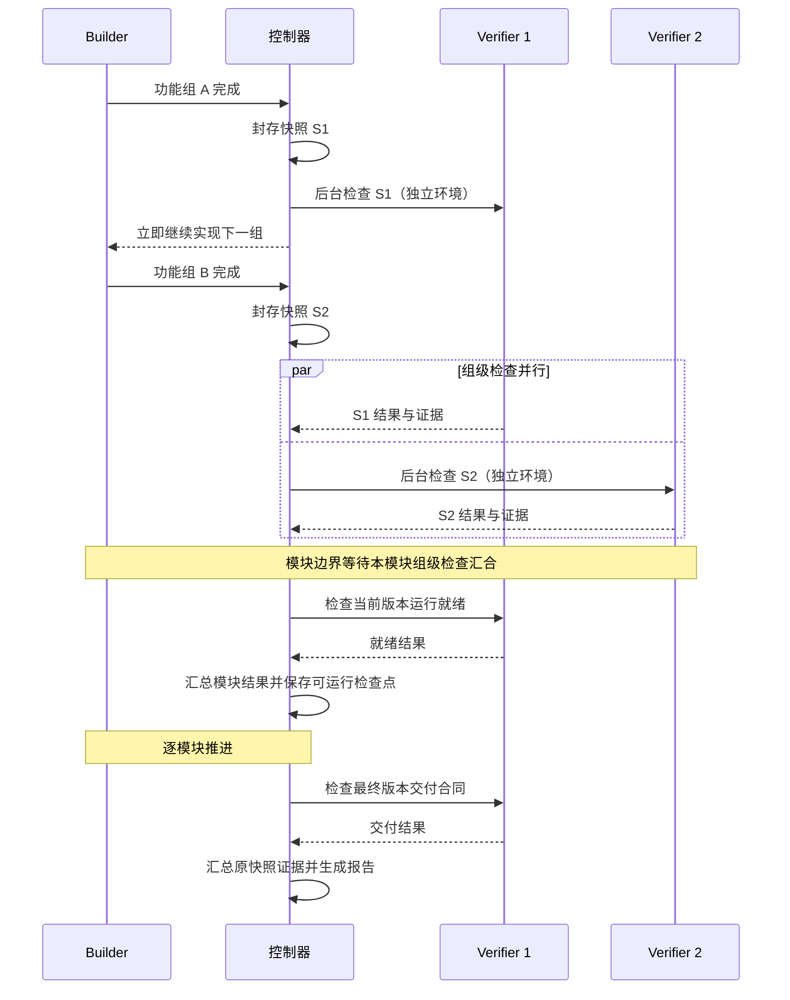

# ShallowCode

**按结构化需求开发应用，并记录可追溯的行为验收证据。**

ShallowCode 读取 `requirements.yaml`，按依赖和功能分组交给 Pi Builder 实现；独立 Verifier 编写并执行检查程序，在真实浏览器中逐条核对场景里的 GIVEN / WHEN / THEN。构建成功、Builder 自述和开发测试通过都不会直接让需求通过，只有可复现的行为证据才会标记为 `verified`。

默认在各功能组的封存快照上执行检查，模块和最终阶段汇总这些结果，并检查当前版本能否运行和交付。独立语义复核与历史程序重放均需显式开启。

输入是一棵需求树或一个已有 Web 项目；输出是可运行的应用、逐条验收报告，以及可写回原项目的补丁。

- **需求驱动**：ROOT / FOLDER / ATOMIC 需求树、场景、依赖、种子数据和参考图都可以进入实现与验收。
- **独立验收**：Verifier 可从封存源码索引定位实现，自己启动应用、准备数据、驱动浏览器；预期依据需求，独立语义复核不接触目标源码。
- **可恢复**：源码快照、可运行检查点和逐子句证据分开保存，失败修复可以回到最近的可运行版本。
- **可适配**：核心只依赖 `ApplicationContract`，当前提供 Web 适配器。

## 工作方式



1. **解析需求**：读取需求树、场景、依赖、种子和实现指引，建立可执行的需求目录。
2. **功能分组**：轻量 Grouper 在最多 6 轮规划回复内，通过 `validate_grouping` 校验并修订分组，再用 `finish` 提交。工具检查覆盖、依赖、模块和容量，并提供跨组依赖、相邻组合并可行性和模块往返事实；Grouper 结合需求原文，把紧密耦合的状态变化尽量放在同组实现与检查。网关错误分类、SSE 容错与共享恢复沿用 Builder/Verifier 的机制，恢复时保留当前会话和工具结果；网络重试不占规划轮数，全部工作受同一总超时约束。会话保存在私有运行目录的 `grouper-sessions/`。
3. **实现与封存**：Builder 在独立 Worker 中实现、自测和修复；每完成一个功能组，控制器封存源码与数据快照并将组级检查入队，Builder 不等待检查结果，继续实现当前模块的下一组。
4. **模块验收**：切换模块前，等待后台检查完成，在当前快照上执行就绪检查。默认汇总对应功能组原快照的结果；开启历史程序重放时，在当前模块快照执行兼容程序。完成有界修复后进入下一模块。
5. **有界修复**：运行就绪失败或可复现的业务失败进入模块修复；修复后验收修复范围，开启历史重放时同时回归既有通过路径，未改善则恢复修复开始时的完整模块快照。
6. **最终验收与交付**：汇总当前范围的功能组结果，开启历史重放时在最终快照执行兼容程序，再检查当前版本的构建、启动、入口和端口等交付合同。交付失败可触发单独修复。

模块修复最多 2 轮，交付修复最多 3 轮；未接受的修复恢复修复前快照，可运行检查点单独保存。`acceptedSha` 表示可运行检查点，`verified` 来自报告中标注的检查快照上的行为证据。每项结果保留 `snapshotId`；开启最终重放且交付检查通过时，另记录最终检查快照 `verifiedSnapshotId`。

每个检查任务使用本轮输入基线对应的唯一初态。每个 case 从该基线复制声明的数据目录后独立启动，场景中的 GIVEN 由检查程序建立并断言。组级检查随封存启动，模块收口时汇合，按历史重放开关决定是否复验；若项目显式声明固定端口，检查与 Builder 自测仍须遵守资源互斥。每个任务的执行上限为 1 小时，从获得执行槽位开始计时；整次运行的总预算同时生效。

## 架构


| 层 | 负责什么 |
| --- | --- |
| **控制面** | CLI / TUI、Pipeline Controller、Verifier Coordinator：分组、调度、检查点、修复和交付。 |
| **Grouper** | Pi Grouper：在受限会话中校验并提交功能分组，独立统计模型用量。 |
| **Builder** | Pi Builder Worker：实现目标业务代码、运行开发测试、根据失败观测修复。 |
| **Verifier** | Verifier Agent：探索并执行检查程序、汇总证据；按开关进行独立语义复核与历史重放。 |
| **Web 适配器** | 解释项目运行合同、脚手架、Builder 工具、QuickJS 程序执行和 Playwright 浏览器能力。 |
| **运行状态** | 快照、收据、检查报告、Git 检查点和可写回的项目副本。 |

控制器只消费 `ApplicationContract`；`src/adapters/index.ts` 与 `src/adapters/verifier.ts` 在生产装配处注册 `web` 实现。新增应用类型时，核心流程不需要知道端口、HTTP 就绪或浏览器细节。Grouper、Builder 与 Verifier 共用 `src/pi-gateway.ts` 的 Pi 重试策略、SSE 修复、取消和会话完成等待、网关错误转译；管线共用 `GatewayRecovery` 调度退避与 `Retry-After`。Grouper 与 Verifier 在网关恢复时保留当前会话和工具结果，Builder 保持独立 Worker 的进程隔离。模型可用 `SHALLOW_GROUPER_*` / `SHALLOW_BUILDER_*` / `SHALLOW_VERIFIER_*` 分开配置。

## Verifier 如何独立验收


Verifier 是唯一验收引擎。它不消费 Builder 的结论，只消费自己产生的证据收据。

- **任务绑定**：每个 `CheckJob` 固定快照、需求、初态、执行器版本和提示词摘要。
- **组级探索**：功能组封存后联合探索组内待覆盖子句，共享页面观察与定位；按场景分别保存合同和程序。分组在本轮固定并持久化，恢复运行继续沿用。
- **源码定位**：探索优先用 `source_tree` 查看当前快照的文件结构，用 `source_search` 按字面关键词定位实现文件与行号，并用 `source_read` 读取片段；能直接形成完整程序时直接 `check_program`，只有源码不足时才用 `invoke` 补充探测。测试、持久化数据及生成目录不进入索引；源码只作定位背景，不构成行为证据。
- **保存并执行**：确定入口、初态准备与对象身份后，通过 `check_program {contract,source}` 保存合同与程序、生成子句映射，并在独立准备的干净环境执行。返回模型的检查和诊断经过压缩，完整反馈与原始证据保留在私有 artifacts；需要细节时，用返回的 `feedbackRef` 通过 `read_feedback` 读取具体字段或文本窗口。定位与断言须经实际执行确认，提交后复用这次证据。
- **独立语义复核（可选）**：`SHALLOW_VERIFIER_SEMANTIC_REVIEW=1` 开启同组新程序的批量复核，缺省 `0`。复核模型读取需求原文、合同、检查程序和执行证据，不接触 Builder 会话或目标源码。关闭时仍校验合同和证据链、独立复现业务失败；复核批准缓存只由实际复核写入。
- **历史程序重放（可选）**：`SHALLOW_VERIFIER_REPLAY=1` 开启模块、修复与最终阶段的历史程序重放，缺省 `0`；该路径只执行兼容程序，不调用探索或复核模型。开启语义复核时要求程序已批准；关闭时按执行证据判定。两个开关均随运行记录保存，`resume` 沿用原设置。
- **功能组结果汇总**：默认汇总当前候选祖先快照中各功能组的执行结果，每项结论归属报告标注的原检查快照。准备/交付运行合同检查当前版本；功能修复对修复范围重新探索和执行，回滚时保留对应祖先分支的结果。开启重放时按兼容的执行绑定、初态和需求上下文复用历史程序。
- **浏览器执行**：程序在独立操作系统进程的 QuickJS 中使用受控的近原生 Playwright 定位器、链式过滤、鼠标/键盘/触屏及文件选择、下载、新窗口、对话框句柄，支持媒体偏好模拟、页面生命周期、下载取消、控制台与异常观察。定位须严格唯一，并保留需求明确指定的 role/label 语义。宿主统一控制来源、文件、句柄与超时；读取返回 `{id,value}`，`check.action` 关联动作 checkpoint，断言只引用真实观察。负向事件记录动作及明确时间窗口内的实际数量。接口与示例见 [Verifier 浏览器合同](prompts/verifier/web/browser.md)。
- **场景隔离**：每个场景独立准备、执行和记录结果；按开关决定历史程序复用与独立复核。程序故障保留其他场景结论，预算耗尽时提交部分报告。
- **环境与回归**：程序使用独立准备的环境，探索或执行过的环境须重置。修复后验收修复范围，开启历史重放时同时回归既有通过路径；交付检查在一次环境准备中记录就绪证据并完成交付验证。
- **文件与视觉内容**：Web 支持 PNG 图片粘贴、携带文件的投放事件和隔离目录上传；下载的 PDF、PNG、JPEG、WebP 可按页或区域渲染，读取文字位置与像素，并按需进行离线中英文 OCR。实际预览保存在证据附件中，内容断言仍须对应原文结果。
- **局部程序修正**：复核拒绝后，同一作业最多追加一轮修正，只处理被拒程序覆盖的子句，保留其余已批准程序；修正最多 10 分钟，且至多使用剩余时间的一半。
- **无法验证的缺口**：探索模型可对任何缺口说明当前测不了，记录实际尝试与具体原因，逐子句记为 `inconclusive`。相同快照、需求、初态与执行绑定下默认复用诊断；仅对有明确依据的暂时性问题允许重试，应用版本或执行条件变化后重新判断。Web 提供文件名断言、视口调整和宿主文件/配额 fixture，大段二进制证据留在产物中。
- **失败必须复现**：业务失败会在另一个全新的应用、数据和浏览器环境中再跑一次；不能复现就降级为 `inconclusive`。
- **四种结论**：`pass`、`fail`、`blocked`（依赖未满足）、`inconclusive`（执行或解释不足）。全部结果子句为 `pass` 才会把需求标记为 `verified`。

终端同步显示 Verifier 实际执行的环境准备、探索、重放、语义复核与失败复现阶段。验收时，Verifier 的进度和排队数量显示在状态行；拒绝后的程序修正会单独说明。按 `d` 查看详细日志中的拒绝原因和诊断，按 `t` 打开需求树：默认按子树状态着色，按 `v` 切换完整 `requirements.yaml`；按 `c` 展开或收起 Grouper / Builder / Verifier 的花费明细（默认只显示总计）。进度条按 Builder 已实现的需求计数；已实现与是否验证无关，验收结果在需求树上单独标注。程序复核通过只表示测试程序合格，需求验证状态由所标注检查快照的实际验收结果更新。运行结束后 TUI 保持打开，可继续查看花费、需求树与日志，按 `Ctrl+C` 退出；报告、补丁与恢复命令追加在详细日志末尾。

## 快速开始

需要 Node.js >= 22.19.0、npm、Git 和 Playwright Chromium。

```powershell
git clone <仓库地址> ShallowCode
cd ShallowCode
npm.cmd run setup
```

Linux / macOS 使用 `npm run setup`。安装脚本会安装仓库与 `requirements-agent` 的依赖、下载 Chromium、从 `.env.example` 初始化 `.env`，并注册全局 `shallow` 命令。

在 `.env` 中配置模型网关：

```dotenv
OPENAI_API_KEY=...
OPENAI_BASE_URL=...
MODEL=...
```

| 变量 | 用途 |
| --- | --- |
| `OPENAI_API_KEY` / `OPENAI_BASE_URL` / `MODEL` | Grouper、Builder 与 Verifier 共用的默认网关。 |
| `SHALLOW_GROUPER_*` | 单独覆盖 Grouper 的 API key、地址和模型；未设置的字段回退公共配置。单价可用 `SHALLOW_GROUPER_COST_*` 覆盖。 |
| `SHALLOW_BUILDER_*` | 单独覆盖 Builder 的 API key、地址和模型。单价可用 `SHALLOW_BUILDER_COST_*` 覆盖。 |
| `SHALLOW_VERIFIER_*` | 单独覆盖 Verifier 的 API key、地址和模型。单价可用 `SHALLOW_VERIFIER_COST_*` 覆盖。 |
| `REQUIREMENTS_AGENT_*` | 单独覆盖 `shallow req` 使用的网关。 |

三个角色可以分别指向不同模型，例如：

```dotenv
SHALLOW_GROUPER_MODEL=provider/grouper
SHALLOW_BUILDER_MODEL=provider/builder
SHALLOW_VERIFIER_MODEL=provider/verifier
```

模型单价默认按网关地址和模型 id 匹配内置目录；也可以用 `MODEL_COST_*` 或按角色使用 `SHALLOW_GROUPER_COST_*` / `SHALLOW_BUILDER_COST_*` / `SHALLOW_VERIFIER_COST_*` 覆盖。三个角色互不影响，可以分别指向不同网关和模型。

## 常用命令

```powershell
shallow req
shallow build --requirements-dir E:\requirements\demo --output-dir E:\projects\new-web
shallow build --requirements-dir E:\requirements\demo --project E:\projects\existing-web
shallow build resume --run-dir E:\runs\<运行目录>
shallow build apply  --run-dir E:\runs\<运行目录>
```

| 命令 | 作用 |
| --- | --- |
| `shallow req` | 需求整理：对话生成 `requirements/requirements.yaml`；明确提出技术要求时一并生成 `project-intent.md`，支持草稿恢复。 |
| `shallow build` | 在当前目录子树查找唯一的 `requirements.yaml`，开发并交付到当前目录。 |
| `shallow build --output-dir` | 新建项目；没有技术要求的空目录使用 React/Vite + Node Web 模板，有明确技术要求时先初始化对应工程。 |
| `shallow build --project` | 接管已有项目：复制当前源码到独立开发目录，原目录和 Git index 保持不动。 |
| `resume` | 从最近的可运行检查点继续，保留失败尝试历史，沿用原运行的复核与重放设置。 |
| `apply` | 把 `changes.patch` 写回原项目；默认只接受 `delivered`。 |

`npm.cmd start -- <参数>` 与 `shallow build` 等价，参数原样透传。交互终端中 `build` / `resume` 启动后先停留在 TUI 概览，按 Enter 才开始运行；启动前也可以先按 `t` 查看需求树、按 `d` 查看日志。运行结束后页面不会自动关闭，可继续查看花费、需求树与日志，按 `Ctrl+C` 退出。

## 输入与配置

最小需求示例：

```yaml
id: ROOT
name: Demo
type: FOLDER
children:
  - id: REQ-1
    name: Open homepage
    type: ATOMIC
    scenarios:
      - name: Open homepage
        steps:
          - keyword: GIVEN
            content: The application is running.
          - keyword: WHEN
            content: The user opens the application URL.
          - keyword: THEN
            content: The homepage is displayed.
```

可在 `requirements.yaml` 同目录放置 `project-intent.md`，用自然语言写明技术栈、工程形态、数据存储或运行要求。没有明确技术要求时省略该文件；页面类型、风格和参考图不会自动决定技术栈。`shallow req` 会在审阅时展示明确提出的技术意图，确认后与需求一起保存。

项目运行方式由 `shallowcode.config.json` 声明。已有代码会保留并补齐缺少的配置；只有配置时按其声明建立工程。空目录且没有技术意图时使用随附模板；有技术意图时由 Builder 建立最小工程和配置。已有配置中的明确要求若与技术意图冲突，初始化会报告冲突。初始化需通过安装、构建、健康检查和浏览器入口检查，成功后才冻结运行合同并进入功能开发；这一步不表示业务需求已经通过验收。

```json
{
  "adapter": "web",
  "install": [{ "executable": "npm", "args": ["ci"], "cwd": "." }],
  "build": [{ "executable": "npm", "args": ["run", "build"], "cwd": "." }],
  "start": { "executable": "npm", "args": ["run", "start"], "cwd": "." },
  "readyPath": "/health",
  "browserPath": "/",
  "dataPaths": ["storage"],
  "dataEnvVar": "APP_DATA_DIR"
}
```

Windows 上把 `npm` 换成 `npm.cmd`。`start` 必填；`install`、`build`、`tests` 可选。`cwd` 是项目相对路径，解析时拒绝绝对路径和 `..` 越界。`generatedPaths` 声明从源码重建的目录；`dataPaths` 是每个 case 独立复制的数据目录；`extraPorts` 声明固定附加端口，用于协调并发检查，并在交付时核对服务监听。

## 运行结果与恢复

默认运行目录在 `%TMP%/shallowcode-runs/<run-id>`，可用 `SHALLOW_RUN_DIR` 覆盖。非交互运行结束时会打印运行目录、补丁位置，以及总计、Grouper、Builder、Verifier 四组模型用量；交互 TUI 在结束后保持打开，可在详细日志末尾查看同样的路径与恢复命令。三个角色均可单独配置模型与单价，完整明细见 `report.md`。

| 产物 | 内容 |
| --- | --- |
| `result.json` / `report.md` | 交付状态、逐需求与逐场景结果、模型用量和可读报告。 |
| `verifier-report.md` | 逐结果子句的检查快照、判定理由与证据引用。 |
| `changes.patch` | 本轮改动，包含新增文件和二进制变更。 |
| `verifier/` | 快照、合同、检查程序、证据收据和检查报告；只存在于私有运行目录。 |
| `shallow-progress/progress.log` | 对外可见的进度日志，保持 untracked。 |

冻结运行记录使用版本 4；`resume` 与 `apply` 只接受该格式，较早格式需重新启动运行。初始化中断时可用同一运行目录执行 `resume`，继续使用已经生成的工程文件与原初始化路径。合同冻结后的 `resume` 要求需求（包括技术意图）、运行配置、提示词、Verifier 执行绑定和依赖锁文件匹配；已接受的实现通过可运行检查后继续使用，历史 `verified` 不会带入本轮。`apply` 写回前会核对补丁摘要和每个受影响文件的完整输入内容，受影响文件已被修改时拒绝写回。

## 交付状态

| 状态 | 含义 | 退出码 |
| --- | --- | --- |
| `delivered` | 当前范围在报告标注的检查快照上全部 `verified`，且交付检查通过。 | 0 |
| `partial` | 交付检查通过，当前范围仍有失败、受阻或未完成验收的需求；可用 `apply --allow-partial` 写回。 | 2 |
| `failed` | 交付失败或运行异常。 | 1 |

## 开发与验证

```powershell
npm.cmd run typecheck
npm.cmd test
npm.cmd run test:browser
npm.cmd run test:all
```

真实网关冒烟需要显式设置 `RUN_CREDENTIAL_SMOKE=1` 并提供凭证，默认跳过。

| 路径 | 内容 |
| --- | --- |
| `index.ts`、`src/cli.ts` | 入口、参数解析、运行目录与恢复。 |
| `src/verifier-pipeline.ts` | 主调度、模块边界、修复回归和交付。 |
| `src/application/` | `ApplicationContract`、适配器注册表和候选运行。 |
| `src/adapters/web/` | Web 生命周期、脚手架、Builder 工具和交付检查。 |
| `src/verifier/`、`prompts/verifier/` | Verifier 内核、Web 执行器、QuickJS 程序和中文提示词。 |
| `test/` | 控制器、Verifier、应用适配与真实 Chromium 用例。 |

当前提供 Web 适配器；Verifier 使用受控的 Chromium 桌面环境，以及宿主提供的文件与存储配额 fixture。总流程使用 Mermaid 时序图；架构与 Verifier 内部流程的源规格在 `assets/diagrams/specs/`，生成静态 SVG 嵌入 README。具体合同、修改流程和测试入口见 [AGENTS.md](AGENTS.md)。
