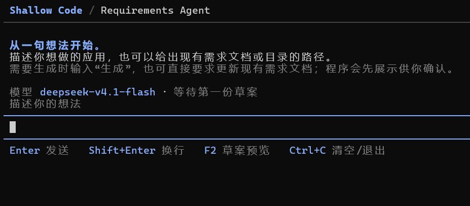
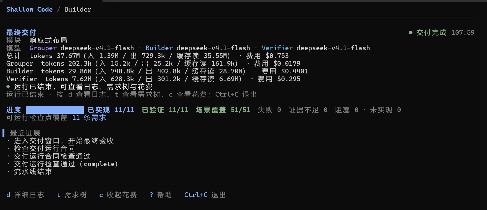
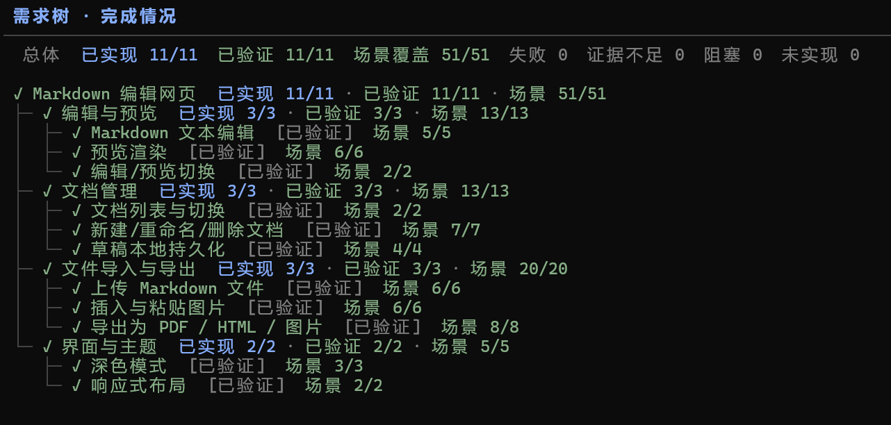
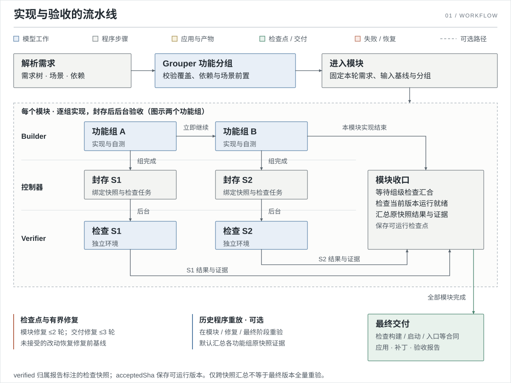

# ShallowCode

**从结构化需求生成可运行的 Web 应用，并提供可追溯的行为验收报告。**

ShallowCode 读取 `requirements.yaml`（仓库内置需求解析Agent），由 Grouper 分组、Builder 实现、独立 Verifier 在真实浏览器中验收。支持新建应用、就地开发已有项目，以及中断续跑和需求变更迭代。

## 快速开始

需要 Node.js >= 22.19.0、npm 和 Git。

```powershell
git clone https://github.com/TheaDust/shallow-code.git
cd shallow-code
npm.cmd run setup
```

`setup` 会安装依赖与 Chromium、初始化 `.env` 并注册 `shallow` 命令。Linux / macOS 使用 `npm`。

在 `.env` 中填写模型网关，然后生成需求并开始开发：

```dotenv
OPENAI_API_KEY=...
OPENAI_BASE_URL=...
MODEL=...
```

```powershell
shallow req
shallow build
```

`shallow req` 生成 `requirements/requirements.yaml`；`shallow build` 自动查找当前目录子树中唯一的需求文件，并交付到当前目录。Grouper、Builder、Verifier 可分别使用 `SHALLOW_GROUPER_*`、`SHALLOW_BUILDER_*`、`SHALLOW_VERIFIER_*` 配置模型与网关，完整配置见 [.env.example](.env.example)。

交互终端中按 **Enter** 开始，`t` 查看需求树，`d` 查看日志，`c` 展开费用；运行结束后可继续查看，按 `Ctrl+C` 退出。进度条表示已实现数量，验收状态在需求树中单独显示。

<details>
<summary>终端预览</summary>

`shallow req` 从一句想法开始，也可以给出已有需求文档或目录；需要生成时输入“生成”，程序先展示草案供确认：



`shallow build` 运行结束后显示交付状态、费用和进度；按 `t` 打开需求树：





</details>

## 常用命令

| 场景                 | 命令                                                                         |
| -------------------- | ---------------------------------------------------------------------------- |
| 指定需求与新项目目录 | `shallow build --requirements-dir ./requirements --output-dir ./new-app`   |
| 接管已有项目         | `shallow build --requirements-dir ./requirements --project ./existing-app` |
| 中断后继续或需求更新后迭代 | 在项目目录执行 `shallow build`                                       |

`build` 直接修改当前目录；`--project` / `--output-dir` 可显式指定开发目录。首次构建、中断后继续、完成后需求更新都使用同一条命令，以该目录当前的代码、需求和运行配置为准。每次运行独立保存日志与验收证据，控制器检查点使用私有 Git 存储，保留项目原有分支与 Git index。

`shallow-progress/implementation.json` 在每个功能组封存后记录已完成实现的需求摘要。再次运行时，内容未变的已完成需求进入本轮独立验收，新增、变更和未完成的需求继续开发；历史进度不算本轮验收通过。当前文件包含的中断改动和用户修改作为新的输入保留。初始化中断也直接重跑 `build`，根据现有工程文件补齐初始化。

Verifier 在 `check_program` 生成程序后立即保存私有程序缓存；模型尚未提交整组结果时中断，已生成程序也可复用。下一次 `build` 按项目目录、需求及其前序依赖摘要、执行合同和声明的初始数据检查兼容性，直接在当前快照中执行兼容程序，缺失或无法完整执行的部分再探索。缓存只包含程序与验收合同，本轮结果仍须由新的执行证据产生；真实业务断言失败保留失败结果并进入修复。

## 工作方式



每完成一个功能组，控制器封存快照并启动后台验收，Builder 继续下一组。模块边界汇合检查结果、执行有界修复，最后检查交付合同。

## 架构与验收


核心通过 `ApplicationContract` 调度，当前提供 Web 适配器；快照、检查程序和证据保存在工作区外的私有运行目录。

需求整理、Grouper、Builder 与 Verifier 都是基于 Pi SDK（`@earendil-works/pi-ai`、`pi-coding-agent`）构建的 agent，交互终端使用 `pi-tui`。Grouper、Builder 与 Verifier 共用网关重试、SSE 修复与恢复机制。


Verifier 按场景隔离应用、数据和浏览器，依据需求原文逐子句检查实际观察；业务失败须在新环境复现。全部结果子句通过才标记为 `verified`，结论归属报告标注的检查快照。

默认汇总本轮各功能组原快照结果，并检查当前版本的交付合同。兼容的跨次程序在首次检查中直接执行，不要求开启重放开关。设置 `SHALLOW_VERIFIER_SEMANTIC_REVIEW=1` 开启独立语义复核（跨次复用程序仍须本轮复核），`SHALLOW_VERIFIER_REPLAY=1` 开启模块与最终版本的额外程序重放；两者默认关闭，每次 `build` 使用当前设置。执行接口见 [Verifier 浏览器合同](prompts/verifier/web/browser.md)。

## 项目输入

| 文件                          | 内容                                                               |
| ----------------------------- | ------------------------------------------------------------------ |
| `requirements.yaml`         | 需求树、依赖与 GIVEN / WHEN / THEN 场景，由 `shallow req` 生成。 |
| `project-intent.md`（可选） | 与需求同目录，声明技术栈、存储或运行要求。                         |
| `shallowcode.config.json`   | 位于项目根目录，声明安装、构建、启动与数据隔离方式。               |

新项目按技术意图初始化，未指定时使用 React/Vite + Node 模板；已有项目保留源码并补齐缺少的运行配置。持久化数据通过 `dataPaths` / `dataEnvVar` 声明，按场景隔离。

<details>
<summary>最小需求与运行配置示例</summary>

`requirements.yaml`：

```yaml
id: ROOT
name: Demo
type: FOLDER
children:
  - id: REQ-1
    name: Open homepage
    type: ATOMIC
    scenarios:
      - name: Open homepage
        steps:
          - keyword: GIVEN
            content: The application is running.
          - keyword: WHEN
            content: The user opens the application URL.
          - keyword: THEN
            content: The homepage is displayed.
```

`shallowcode.config.json`：

```json
{
  "adapter": "web",
  "install": [{ "executable": "npm", "args": ["ci"], "cwd": "." }],
  "build": [{ "executable": "npm", "args": ["run", "build"], "cwd": "." }],
  "start": { "executable": "npm", "args": ["run", "start"], "cwd": "." },
  "readyPath": "/health",
  "browserPath": "/",
  "dataPaths": ["storage"],
  "dataEnvVar": "APP_DATA_DIR"
}
```

Windows 下将配置中的 `npm` 换成 `npm.cmd`。`start` 必填，命令的 `cwd` 使用项目相对路径。

</details>

## 运行结果

默认运行目录为系统临时目录下的 `shallowcode-runs/<run-id>`，可用 `SHALLOW_RUN_DIR` 覆盖。目录内包含结果与用量报告 `result.json` / `report.md`、逐条证据报告 `verifier-report.md` 和私有检查点 `checkpoints.git/`；应用代码直接保存在项目目录。续跑读取项目中的进度，不依赖上一次私有运行目录。跨次程序缓存在该运行根目录的 `.verifier-programs/<项目路径摘要>/` 中；清除缓存或更换运行根目录后，首次检查会重新探索。

| 状态          | 含义                                                       | 退出码 |
| ------------- | ---------------------------------------------------------- | ------ |
| `delivered` | 当前范围在报告标注的快照上全部验证通过，且交付检查通过。   | 0      |
| `partial`   | 交付检查通过，验收仍有缺口；写回需加 `--allow-partial`。 | 2      |
| `failed`    | 交付失败或运行异常。                                       | 1      |

## 开发

源码索引、修改约定与局部验证入口见 [AGENTS.md](AGENTS.md)。完整检查使用 `npm.cmd run test:all`；真实网关冒烟需设置 `RUN_CREDENTIAL_SMOKE=1` 并提供凭证，默认跳过。
