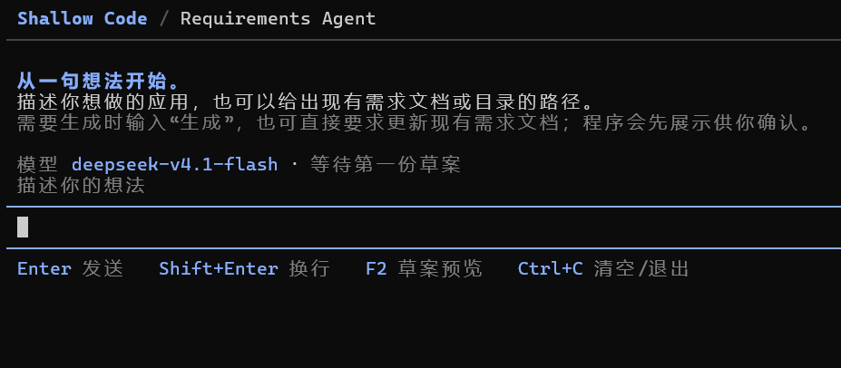
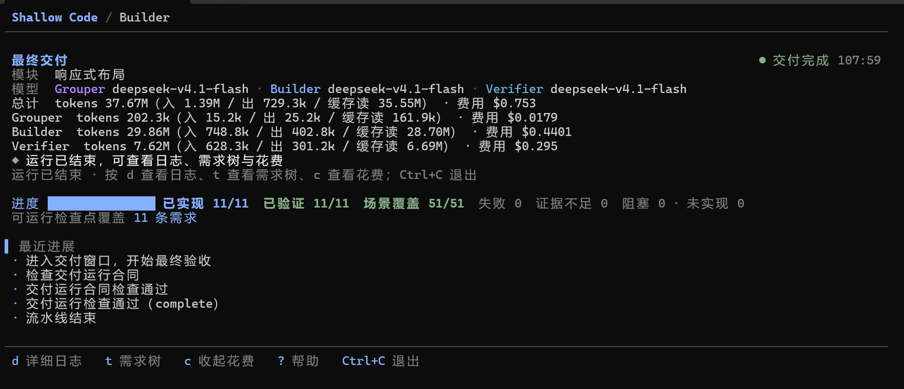
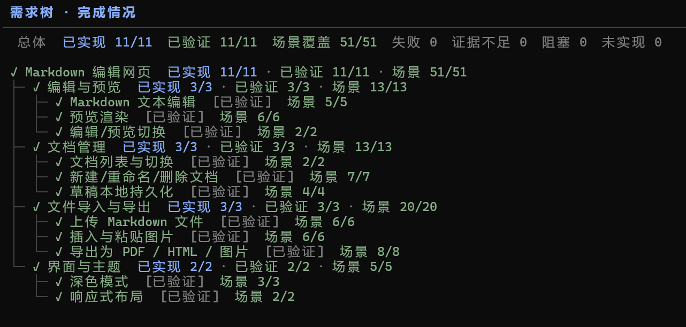
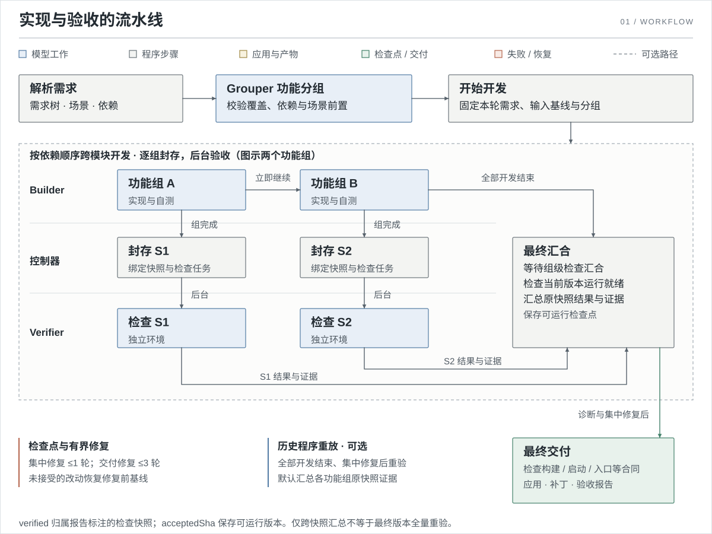
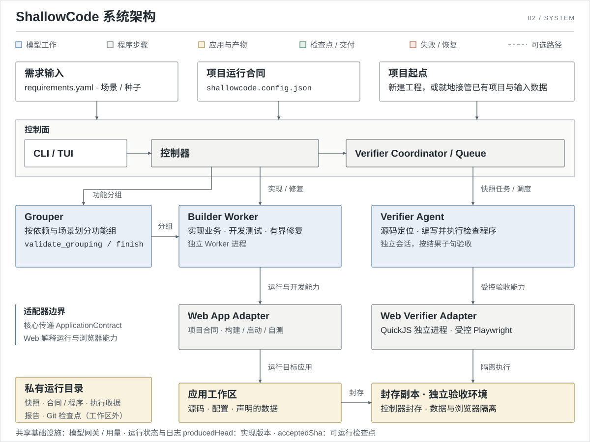
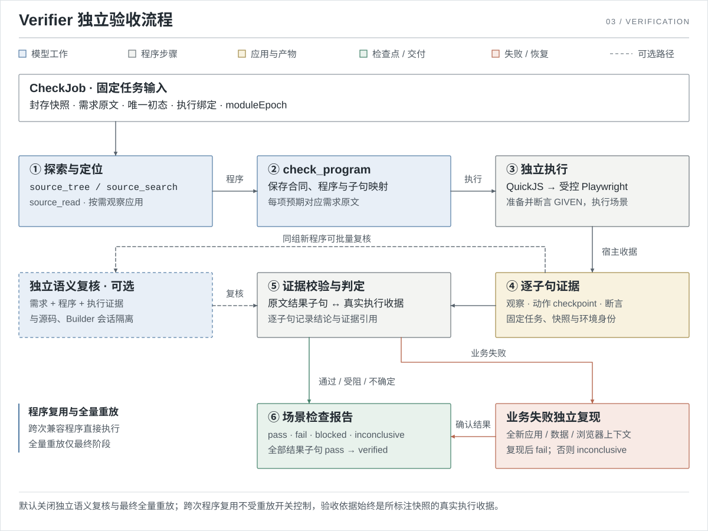

# ShallowCode

**从结构化需求生成可运行的 Web 应用，并提供可追溯的行为验收报告。**

ShallowCode 读取 `requirements.yaml`（仓库内置需求解析Agent），由 Grouper 分组、Builder 实现、独立 Verifier 在真实浏览器中验收。支持新建应用、就地开发已有项目，以及中断续跑和需求变更迭代。

## 快速开始

需要 Node.js >= 22.19.0、npm 和 Git。

```powershell
git clone https://github.com/TheaDust/shallow-code.git
cd shallow-code
npm.cmd run setup
```

`setup` 会安装依赖与 Chromium、初始化 `.env` 并注册 `shallow` 命令。Linux / macOS 使用 `npm`。

在 `.env` 中填写模型网关，然后生成需求并开始开发：

```dotenv
OPENAI_API_KEY=...
OPENAI_BASE_URL=...
MODEL=...
```

```powershell
shallow req
shallow build
```

`shallow req` 生成 `requirements/requirements.yaml`；`shallow build` 自动查找当前目录子树中唯一的需求文件，并交付到当前目录。Grouper、Builder、Verifier 可分别使用 `SHALLOW_GROUPER_*`、`SHALLOW_BUILDER_*`、`SHALLOW_VERIFIER_*` 配置模型与网关，完整配置见 [.env.example](.env.example)。

交互终端中按 **Enter** 开始，`t` 查看需求树，`d` 查看日志，`c` 展开费用；运行结束后可继续查看，按 `Ctrl+C` 退出。进度条表示已实现数量，验收状态在需求树中单独显示。

<details>
<summary>终端预览</summary>

`shallow req` 从一句想法开始，也可以给出已有需求文档或目录；需要生成时输入“生成”，程序先展示草案供确认：



`shallow build` 运行结束后显示交付状态、费用和进度；按 `t` 打开需求树：





</details>

## 常用命令

| 场景                 | 命令                                                                         |
| -------------------- | ---------------------------------------------------------------------------- |
| 指定需求与新项目目录 | `shallow build --requirements-dir ./requirements --output-dir ./new-app`   |
| 接管已有项目         | `shallow build --requirements-dir ./requirements --project ./existing-app` |
| 中断后继续或需求更新后迭代 | 在项目目录执行 `shallow build`                                       |

`build` 直接修改当前目录；`--project` / `--output-dir` 可显式指定开发目录。首次构建、中断后继续、完成后需求更新都使用同一条命令，以该目录当前的代码、需求和运行配置为准。每次运行独立保存日志与验收证据，控制器检查点使用私有 Git 存储，保留项目原有分支与 Git index。

开发与验收范围由当前需求和本地实现进度确定。需求标题中的 Evolution、Stage 或 Phase 作为普通名称保留。当前需求树中的全部条目均参与本轮验收；从已有应用开始时，树外依赖作为业务上下文，新项目中的未知依赖仍报错。

各环节使用固定上限：初始化技术检查每次 3 分钟，工程初始化每次 15 分钟、最多 4 次；Grouper 每次 12 分钟；Builder 每次 90 分钟，中断续跑每次 45 分钟；Verifier 每个任务从获得执行槽位起最多 60 分钟；交付检查每次 12 分钟。模块修复最多 2 轮，交付修复最多 3 轮。控制器依次推进当前需求范围内的开发与验收。

`shallow-progress/implementation.json` 在每个功能组封存后记录已完成实现的需求摘要。再次运行时，内容未变的已完成需求进入本轮独立验收，新增、变更和未完成的需求继续开发；历史进度不算本轮验收通过。当前文件包含的中断改动和用户修改作为新的输入保留。初始化中断也直接重跑 `build`，根据现有工程文件补齐初始化。

Verifier 在 `check_program` 生成程序后立即保存私有程序缓存；模型尚未提交整组结果时中断，已生成程序也可复用。下一次 `build` 按项目目录、需求及其前序依赖摘要、执行合同和声明的初始数据检查兼容性，直接在当前快照中执行兼容程序，缺失或无法完整执行的部分再探索。缓存只包含程序与验收合同，本轮结果仍须由新的执行证据产生；真实业务断言失败保留失败结果并进入修复。

## 工作方式



每完成一个功能组，控制器封存快照并启动后台验收，Builder 按依赖顺序跨模块继续开发。全部开发结束后统一等待后台验收、汇总原快照证据并检查交付合同，再执行失败诊断与集中修复。项目声明的固定共享端口仍须与 Builder 自测互斥。

## 架构与验收



核心通过 `ApplicationContract` 调度，当前提供 Web 适配器；快照、检查程序和证据保存在工作区外的私有运行目录。

需求整理、Grouper、Builder 与 Verifier 都是基于 Pi SDK（`@earendil-works/pi-ai`、`pi-coding-agent`）构建的 agent，交互终端使用 `pi-tui`。Grouper、Builder 与 Verifier 共用网关重试、SSE 修复与恢复机制。



Verifier 按场景隔离应用、数据和浏览器，依据需求原文逐子句检查实际观察；业务失败须在新环境复现。全部结果子句通过才标记为 `verified`，结论归属报告标注的检查快照。

同一验收任务内保留独占候选槽位的依赖、构建产物与一个浏览器进程，复用前检查源码、构建及依赖完整性。每次执行重新启动应用、复制声明的初始数据并创建独立浏览器上下文与证据身份；探索环境在首次调用执行能力时才创建。任务完成或取消后统一释放保留资源。

默认在全部开发结束后汇总本轮各功能组原快照结果，并检查当前版本的交付合同。兼容的跨次程序在首次检查中直接执行，不要求开启重放开关。设置 `SHALLOW_VERIFIER_SEMANTIC_REVIEW=1` 开启独立语义复核（跨次复用程序仍须本轮复核），`SHALLOW_VERIFIER_REPLAY=1` 仅开启所有模块完成后的全量程序重放及集中修复后的最终收口检查；两者默认关闭，每次 `build` 使用当前设置。失败场景先由 Verifier 在固定候选上局部核对并修正程序；有效业务反例集中交给 Builder，修复期间只检查目标场景。程序局部处理、修复目标检查和跨次程序复用均不受全量重放开关控制。业务集中修复最多一轮，交付合同修复在最终行为收口前完成；最后收口的新失败保留报告。修复 Builder 可通过 `repair_diff` 按需读取兼容历史通过快照与失败快照的应用代码差异。执行接口见 [Verifier 浏览器合同](prompts/verifier/web/browser.md)。

## 项目输入

| 文件                          | 内容                                                               |
| ----------------------------- | ------------------------------------------------------------------ |
| `requirements.yaml`         | 需求树、依赖与 GIVEN / WHEN / THEN 场景，由 `shallow req` 生成。 |
| `project-intent.md`（可选） | 与需求同目录，声明技术栈、存储或运行要求。                         |
| `shallowcode.config.json`   | 位于项目根目录，声明安装、构建、启动与数据隔离方式。               |

新项目按技术意图初始化，未指定时使用 React/Vite + Node 模板；已有项目保留源码并补齐缺少的运行配置。持久化数据通过 `dataPaths` / `dataEnvVar` 声明，按场景隔离。

<details>
<summary>最小需求与运行配置示例</summary>

`requirements.yaml`：

```yaml
id: ROOT
name: Demo
type: FOLDER
children:
  - id: REQ-1
    name: Open homepage
    type: ATOMIC
    scenarios:
      - name: Open homepage
        steps:
          - keyword: GIVEN
            content: The application is running.
          - keyword: WHEN
            content: The user opens the application URL.
          - keyword: THEN
            content: The homepage is displayed.
```

`shallowcode.config.json`：

```json
{
  "adapter": "web",
  "install": [{ "executable": "npm", "args": ["ci"], "cwd": "." }],
  "build": [{ "executable": "npm", "args": ["run", "build"], "cwd": "." }],
  "start": { "executable": "npm", "args": ["run", "start"], "cwd": "." },
  "readyPath": "/health",
  "browserPath": "/",
  "dataPaths": ["storage"],
  "dataEnvVar": "APP_DATA_DIR"
}
```

Windows 下将配置中的 `npm` 换成 `npm.cmd`。`start` 必填，命令的 `cwd` 使用项目相对路径。

</details>

## 运行结果

默认运行目录为系统临时目录下的 `shallowcode-runs/<run-id>`，可用 `SHALLOW_RUN_DIR` 覆盖。目录内包含结果与用量报告 `result.json` / `report.md`、逐条证据报告 `verifier-report.md` 和私有检查点 `checkpoints.git/`；应用代码直接保存在项目目录。续跑读取项目中的进度，不依赖上一次私有运行目录。跨次程序缓存在该运行根目录的 `.verifier-programs/<项目路径摘要>/` 中；清除缓存或更换运行根目录后，首次检查会重新探索。

`result.json` 中的逐项验收结果关联来源任务、检查快照和已提交报告；`verifier-report.md` 提供需求原文、任务、合同、程序源码与证据的链接。没有提交报告的任务保留实际故障原因。`run-ledger.jsonl` 中的修复决策记录基线、候选、保留版本及相关检查任务；交付检查任务可在 `verifier/delivery/<jobId>.json` 中查询。归档完整证据时保留整个运行目录。

| 状态          | 含义                                                       | 退出码 |
| ------------- | ---------------------------------------------------------- | ------ |
| `delivered` | 当前范围在报告标注的快照上全部验证通过，且交付检查通过。   | 0      |
| `partial`   | 交付检查通过，验收仍有缺口。 | 2      |
| `failed`    | 交付失败或运行异常。                                       | 1      |

## 开发

### Builder 自检 baseline

实验对照使用同一个 Pi 编码 Agent，一次接收完整需求，自主实现、测试并根据自检修复。它复用工程初始化、Builder 模型配置、工具、技能和项目运行合同，开发阶段由一个会话完成。

```powershell
npm.cmd run baseline -- --requirements-dir <需求目录> --output-dir <新项目目录>
npm.cmd run baseline -- --requirements-dir <需求目录> --project <已有项目目录> --timeout-ms 5400000
```

默认读取仓库 `.env`，进程环境变量优先；使用 `SHALLOW_BUILDER_*` 模型、网关、单价及上下文配置。`--timeout-ms` 为整段开发会话的时间上限，默认 90 分钟，包含参考图片预检及降级重试；初始化与最终技术检查单独计时，总耗时包含所有阶段。参考图片沿用 `SHALLOW_REFERENCE_IMAGES`。

私有记录位于 `SHALLOW_RUN_DIR` 或临时目录的 `shallowcode-runs/baseline-*`：`baseline.json` 保存模型配置、需求摘要、初始化前后的文件摘要和运行合同，`prompt.json` 保存开发提示词，`self-check.md` 保存 Agent 自检回复，`result.json` 保存状态、模型用量、最终文件摘要与耗时，Pi 会话保存在同一运行目录。初始化和图片预检的已知用量计入总量；`usageComplete: false` 表示有执行用量缺失，费用仅为已知部分。

退出码 0 表示 Agent 正常结束且最终技术检查通过；退出码 1 包括执行失败、超时、运行配置改变或技术检查失败。技术检查在独立副本中安装、构建并打开应用入口，不向 Agent 反馈。需求满足率须由另行准备的隐藏测试在最终版本评估。对照实验使用相同输入和初始工程、固定模型及配置，记录各方法实际总投入；此入口自身不保证与完整 Shallow 管线等预算。

ARC 两组实验使用 `npm.cmd run experiment -- <list|plan|prepare|run|summarize>`，默认输入为相邻的 `../arc-bench`。任务筛选、统一生成时限、独立评分、断点续跑与结果汇总见 [实验说明](EXPERIMENTS.md)。

源码索引、修改约定与局部验证入口见 [AGENTS.md](AGENTS.md)。完整检查使用 `npm.cmd run test:all`；真实网关冒烟需设置 `RUN_CREDENTIAL_SMOKE=1` 并提供凭证，默认跳过。
