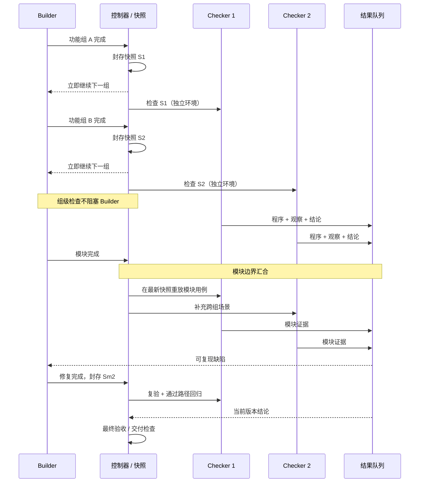
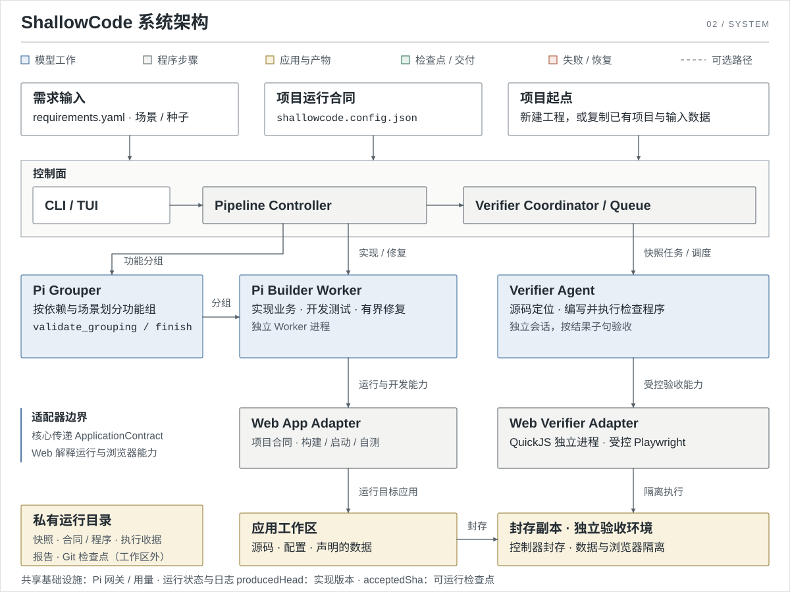

# ShallowCode

**把结构化需求，交付成经过独立验收的可运行应用。**

ShallowCode 读取 `requirements.yaml`，按依赖和功能分组交给 Pi Builder 实现；再由独立 Checker 在真实浏览器中重放检查程序，逐条核对场景里的 GIVEN / WHEN / THEN。构建成功、Builder 自述和开发测试通过都不会直接让需求通过，只有可复现的行为证据才会标记为 `verified`。

输入是一棵需求树或一个已有 Web 项目；输出是可运行的应用、逐条验收报告，以及可写回原项目的补丁。

- **需求驱动**：ROOT / FOLDER / ATOMIC 需求树、场景、依赖、种子数据和参考图都可以进入实现与验收。
- **独立验收**：Checker 与目标源码、diff、Builder 会话隔离，自己启动应用、准备数据、驱动浏览器。
- **可恢复**：源码快照、可运行检查点和逐子句证据分开保存，失败修复可以回到最近的可运行版本。
- **可适配**：核心只依赖 `ApplicationContract`，当前提供 Web 适配器。

## 工作方式



1. **解析需求**：读取需求树、场景、依赖、种子和实现指引，建立可执行的需求目录。
2. **功能分组**：按依赖和功能边界把需求拆成小批次，交给 Builder。
3. **实现与封存**：Builder 在独立 Worker 中实现、自测和修复；每完成一个功能组，控制器封存源码与数据快照并把检查任务入队，Builder 不等检查完成就继续下一组。
4. **并行检查与模块汇合**：Checker 在独立应用、数据和浏览器中并行重放检查程序；到模块边界时汇合，回归已通过的路径并处理缺陷。
5. **有界修复**：只有可复现的失败才进入修复；修复后复验，未改善则回滚到检查点。
6. **最终验收与交付**：在当前范围上重新检查全部场景，再执行构建、启动、入口和端口等交付检查。

模块修复最多 2 轮，交付修复最多 3 轮；未改善的修复会回滚到最近的可运行检查点。`acceptedSha` 表示可运行检查点，`verified` 表示当前候选的独立行为证据；两者分开记录，历史通过不会自动授予本轮通过。

## 架构



| 层 | 负责什么 |
| --- | --- |
| **控制面** | CLI / TUI、Pipeline Controller、Checker Coordinator：分组、调度、检查点、修复和交付。 |
| **Builder** | Pi Builder Worker：实现目标业务代码、运行开发测试、根据失败观测修复。 |
| **Checker** | Checker Agent：探索检查程序、全新环境重放、独立语义复核、汇总证据。 |
| **Web 适配器** | 解释项目运行合同、脚手架、Builder 工具、QuickJS 程序执行和 Playwright 浏览器能力。 |
| **运行状态** | 快照、收据、检查报告、Git 检查点和可写回的项目副本。 |

控制器只消费 `ApplicationContract`；`src/adapters/index.ts` 与 `src/adapters/checker.ts` 在生产装配处注册 `web` 实现。新增应用类型时，核心流程不需要知道端口、HTTP 就绪或浏览器细节。Builder 与 Checker 各自通过模型网关调用模型，可用 `SHALLOW_BUILDER_*` / `SHALLOW_CHECKER_*` 分开配置。

## Checker 如何独立验收


Checker 是唯一验收引擎。它不消费 Builder 的结论，只消费自己产生的证据收据。

- **任务绑定**：每个 `CheckJob` 固定快照、需求、初态、执行器版本和提示词摘要。
- **先复用，再探索**：执行绑定和初态一致时复用已批准程序；覆盖不足时由探索模型调用声明的能力，保存检查程序和验收合同。
- **宿主重放**：程序在独立进程的 QuickJS 中运行，只能通过受控 Playwright 能力访问应用；每个 GIVEN、WHEN 和结果子句都对应宿主产生的证据收据。
- **独立语义复核**：复核模型只读需求原文、合同和收据，不接触 Builder 会话或目标源码。
- **失败必须复现**：业务失败会在另一个全新的应用、数据和浏览器环境中再跑一次；不能复现就降级为 `inconclusive`。
- **四种结论**：`pass`、`fail`、`blocked`（依赖未满足）、`inconclusive`（执行或解释不足）。全部结果子句为 `pass` 才会把需求标记为 `verified`。

终端同步显示 Checker 的环境准备、探索、独立重放、语义复核、复核复用与失败复现。Builder 运行时，Checker 的进度和排队数量显示在后台一行；拒绝后的程序修正会单独说明。按 `d` 查看详细日志中的拒绝原因和诊断。程序复核通过只表示测试程序合格，需求计数仍由当前版本的正式验收结果更新。

## 快速开始

需要 Node.js >= 22.19.0、npm、Git 和 Playwright Chromium。

```powershell
git clone <仓库地址> ShallowCode
cd ShallowCode
npm.cmd run setup
```

Linux / macOS 使用 `npm run setup`。安装脚本会安装仓库与 `requirements-agent` 的依赖、下载 Chromium、从 `.env.example` 初始化 `.env`，并注册全局 `shallow` 命令。

在 `.env` 中配置模型网关：

```dotenv
OPENAI_API_KEY=...
OPENAI_BASE_URL=...
MODEL=...
```

| 变量 | 用途 |
| --- | --- |
| `OPENAI_API_KEY` / `OPENAI_BASE_URL` / `MODEL` | Builder 与 Checker 共用的默认网关。 |
| `SHALLOW_BUILDER_*` | 单独覆盖 Builder 的 API key、地址和模型。 |
| `SHALLOW_CHECKER_*` | 单独覆盖 Checker 与功能分组的 API key、地址和模型。 |
| `REQUIREMENTS_AGENT_*` | 单独覆盖 `shallow req` 使用的网关。 |

模型单价默认按网关地址和模型 id 匹配内置目录；也可以用 `MODEL_COST_*` 或 `<组件>_COST_*` 覆盖。

## 常用命令

```powershell
shallow req
shallow build --requirements-dir E:\requirements\demo --output-dir E:\projects\new-web
shallow build --requirements-dir E:\requirements\demo --project E:\projects\existing-web
shallow build resume --run-dir E:\runs\<运行目录>
shallow build apply  --run-dir E:\runs\<运行目录>
```

| 命令 | 作用 |
| --- | --- |
| `shallow req` | 需求整理：对话生成 `requirements/requirements.yaml`，支持草稿恢复。 |
| `shallow build` | 在当前目录子树查找唯一的 `requirements.yaml`，开发并交付到当前目录。 |
| `shallow build --output-dir` | 新建项目；空目录会写入随附的 React/Vite + Node Web 模板。 |
| `shallow build --project` | 接管已有项目：复制当前源码到独立开发目录，原目录和 Git index 保持不动。 |
| `resume` | 从最近的可运行检查点继续，保留失败尝试历史，本轮重新验收。 |
| `apply` | 把 `changes.patch` 写回原项目；默认只接受 `delivered`。 |

`npm.cmd start -- <参数>` 与 `shallow build` 等价，参数原样透传。

## 输入与配置

最小需求示例：

```yaml
id: ROOT
name: Demo
type: FOLDER
children:
  - id: REQ-1
    name: Open homepage
    type: ATOMIC
    scenarios:
      - name: Open homepage
        steps:
          - keyword: GIVEN
            content: The application is running.
          - keyword: WHEN
            content: The user opens the application URL.
          - keyword: THEN
            content: The homepage is displayed.
```

项目运行方式由 `shallowcode.config.json` 声明；新项目可省略，脚手架会写入默认配置。

```json
{
  "adapter": "web",
  "install": [{ "executable": "npm", "args": ["ci"], "cwd": "." }],
  "build": [{ "executable": "npm", "args": ["run", "build"], "cwd": "." }],
  "start": { "executable": "npm", "args": ["run", "start"], "cwd": "." },
  "readyPath": "/health",
  "browserPath": "/",
  "dataPaths": ["storage"],
  "dataEnvVar": "APP_DATA_DIR"
}
```

Windows 上把 `npm` 换成 `npm.cmd`。`start` 必填；`install`、`build`、`tests` 可选。`cwd` 是项目相对路径，解析时拒绝绝对路径和 `..` 越界。`generatedPaths` 声明从源码重建的目录；`dataPaths` 是每个 case 独立复制的数据目录；`extraPorts` 只在交付时预留。

## 运行结果与恢复

默认运行目录在 `%TMP%/shallowcode-runs/<run-id>`，可用 `SHALLOW_RUN_DIR` 覆盖。结束时会打印运行目录、补丁位置，以及总计、Builder、Checker 三组模型用量。

| 产物 | 内容 |
| --- | --- |
| `result.json` / `report.md` | 交付状态、逐需求与逐场景结果、模型用量和可读报告。 |
| `changes.patch` | 本轮改动，包含新增文件和二进制变更。 |
| `checker/` | 快照、合同、检查程序、证据收据和检查报告；只存在于私有运行目录。 |
| `shallow-progress/progress.log` | 对外可见的进度日志，保持 untracked。 |

`resume` 要求需求、运行配置、提示词、Checker 执行绑定和依赖锁文件匹配；已接受的实现通过可运行检查后继续使用，历史 `verified` 不会带入本轮。`apply` 写回前会核对补丁摘要和每个受影响文件的完整输入内容，受影响文件已被修改时拒绝写回。

## 交付状态

| 状态 | 含义 | 退出码 |
| --- | --- | --- |
| `delivered` | 当前范围全部 `verified`，且交付检查通过。 | 0 |
| `partial` | 有未确认项；可用 `apply --allow-partial` 写回。 | 2 |
| `failed` | 交付失败或运行异常。 | 1 |

## 开发与验证

```powershell
npm.cmd run typecheck
npm.cmd test
npm.cmd run test:browser
npm.cmd run test:all
```

真实网关冒烟需要显式设置 `RUN_CREDENTIAL_SMOKE=1` 并提供凭证，默认跳过。

| 路径 | 内容 |
| --- | --- |
| `index.ts`、`src/cli.ts` | 入口、参数解析、运行目录与恢复。 |
| `src/checker-pipeline.ts` | 主调度、模块边界、修复回归和交付。 |
| `src/application/` | `ApplicationContract`、适配器注册表和候选运行。 |
| `src/adapters/web/` | Web 生命周期、脚手架、Builder 工具和交付检查。 |
| `src/checker/`、`prompts/checker/` | Checker 内核、Web 执行器、QuickJS 程序和中文提示词。 |
| `test/` | 控制器、Checker、应用适配与真实 Chromium 用例。 |

当前提供 Web 适配器；Checker 使用受控的 Chromium 桌面环境，不开放 `page.evaluate`、网络拦截或存储直访。总流程使用 Mermaid 时序图；架构与 Checker 内部流程的源规格在 `assets/diagrams/specs/`，生成静态 SVG 嵌入 README。具体合同、修改流程和测试入口见 [AGENTS.md](AGENTS.md)。
